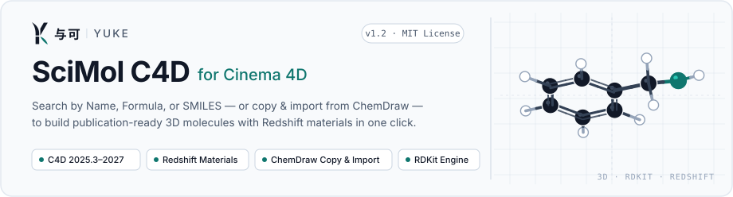

<div align="center">

<picture>
  <source media="(prefers-color-scheme: dark)" srcset="./assets/brand/scimol-hero-en-dark.svg">
  <source media="(prefers-color-scheme: light)" srcset="./assets/brand/scimol-hero-en-light.svg">
  
</picture>

<p>
  <a href="./README.md">简体中文</a> · <b>English</b>
  &nbsp;&nbsp;|&nbsp;&nbsp;
  <a href="#installation--ai-setup">AI One-Click Install</a> · <a href="#cross-dcc-adaptation">Blender / Cross-DCC</a> · <a href="#highlights">Highlights</a> · <a href="#quick-workflow">ChemDraw Workflow</a>
</p>

</div>

Built for **scientific journal cover art, TOC graphics, paper figures, and mechanism animations**: skip manual OBJ/FBX exports and material re-binding — search directly inside Cinema 4D or paste from ChemDraw to generate accurate 3D molecules and materials. **SciMol also shares its decoupled chemistry & geometry blueprint**, empowering any AI assistant to adapt it across C4D versions, renderers, or port it to **Blender, Maya, Houdini**, and more.

## Highlights

| Feature | Details |
| :--- | :--- |
| **ChemDraw Workflow** | Copy any molecule as SMILES (`Ctrl+Alt+C`) and paste straight into SciMol, or import `.cdxml` / `.mol` / `.sdf` files directly |
| **All-in-One Search** | Auto-detects English/Chinese names, formulas (including subscripts like `C₆H₁₂O₆`), and SMILES; ships with an 81-entry offline dictionary plus online PubChem lookup |
| **One-Click Materials** | Switch between Ball-and-Stick, Space-Fill, and Wireframe modes; builds independent materials for atoms and split-color bonds with 5 scientific palettes (`Ctrl+Z` undoable) |
| **Live WYSIWYG Tuning** | Click a thumbnail for a live preview and click another to swap without scene clutter; adjust atom radius, bond thickness, spacing, hydrogens, and per-element scale in real time |
| **Companion Utilities** | Includes recent history, custom favorites folders, and presets; optional **Structure Details** 2D popup offers per-atom/per-bond fine-tuning and planar flattening |

## Installation & AI Setup

### Option 1: Copy & Paste This Prompt to Any AI Assistant (Recommended)

Using **Cursor, Claude Code, Codex, Trae, Windsurf, Antigravity**, or any AI assistant with terminal access? Copy the prompt below and send it to your AI — it will download, set up the isolated chemistry environment, and adapt it to your local Cinema 4D version and renderer automatically:

````text
Please help me install and adapt the Cinema 4D plugin "SciMol C4D" (https://github.com/DeepLeap/scimol-c4d) on this Windows machine:
1. Check whether 64-bit Python (3.10–3.13) is installed; if missing, ask for my confirmation and install Python 3.12 via winget.
2. Download https://github.com/DeepLeap/scimol-c4d (git clone or download & extract the main branch ZIP) into a dedicated folder `%APPDATA%\Maxon\SciMol-C4D` (do NOT place the full repo inside C4D's `library\scripts` folder, as scanning `.runtime` slows down C4D startup).
3. Run `powershell -ExecutionPolicy Bypass -File .\安装运行环境.ps1 -RegisterC4D` inside that directory to create the isolated `.runtime` chemistry environment and register a lightweight icon launcher in Cinema 4D's User Scripts menu.
4. Detect which Cinema 4D version and renderer (Redshift, C4D Standard, Octane, etc.) I have installed: if my setup differs from newer C4D + Redshift, read `docs/AI_ADAPTER_GUIDE.md` (Section 4) and adapt `scimol_c4d/c4d_builder.py` accordingly.
5. Once verified, tell me the installation folder, any compatibility adjustments made, and which Cinema 4D menu item launches the plugin.
````

### Option 2: Manual Setup (3 Steps)

1. **Clone into a dedicated folder** (e.g., `D:\Plugins\scimol-c4d` or `%APPDATA%\Maxon\SciMol-C4D` — **avoid** putting the full repo inside C4D's `library\scripts`)
   ```bash
   git clone https://github.com/DeepLeap/scimol-c4d.git
   ```
2. **Initialize the isolated chemistry runtime & register C4D menu** (requires 64-bit Python 3.10–3.13; **never modifies C4D's built-in Python**, with automatic mirror fallback)
   ```powershell
   powershell -ExecutionPolicy Bypass -File .\安装运行环境.ps1 -RegisterC4D
   ```
3. **Launch in Cinema 4D**: Open or restart C4D and click **Extensions → User Scripts → 分子球棍生成器** (or run `分子球棍生成器.py` via Script Manager).

## Cross-DCC Adaptation

> **Cinema 4D first** out of the box — with an open architectural blueprint so your AI can port the exact same workflow to **Blender, Maya, Houdini, or 3ds Max**.

SciMol cleanly separates **70% DCC-agnostic chemistry parsing, ChemDraw import, 3D geometry & scientific color logic** from **30% host-specific scene/material creation**, running its chemistry backend in an isolated `.runtime` environment outside the host app. Read the complete [**AI Cross-Version & Cross-DCC Adapter Guide (docs/AI_ADAPTER_GUIDE.md)**](./docs/AI_ADAPTER_GUIDE.md).

Want the same one-click molecule generator inside **Blender** (or any other 3D app)? Replace the bracketed target below and paste this prompt to your AI assistant:

````text
Please port the open-source molecule builder https://github.com/DeepLeap/scimol-c4d to [Target App & Renderer: e.g., Blender 4.x / Cycles (or Maya / Houdini / earlier C4D + Octane)]:
1. Clone/download the repository and read `docs/AI_ADAPTER_GUIDE.md` to understand the decoupled data protocol and 3D geometry formulas.
2. Reuse the existing `.runtime` chemistry backend (created by `安装运行环境.ps1`), `scimol_c4d/chemistry_worker.py`, `display_geometry.py`, `appearance_scale.py`, and `COLOR_PRESETS` (supporting name/formula/SMILES search and ChemDraw copy/import) directly without rewriting chemistry logic.
3. Implement native object instancing, PBR/node materials, and a compact sidebar UI in [Target App] following the sphere scaling, multi-bond offset, and split-color bond junction math documented in `scimol_c4d/c4d_builder.py` and the adapter guide.
4. Keep the original attribution "与可 | YUKE (DeepLeap)" and MIT License, and show me how to load and use the ported plugin.
````

## Quick Workflow

```text
Search or Paste/Import from ChemDraw → Click thumbnail → Tune / Apply Palette → Finish
                                              ↑                                    ↓
                                              └──── Click another to swap live ────┘
```

- **ChemDraw Shortcut**: Select a structure, press `Ctrl+Alt+C` (`Edit → Copy As → SMILES`), and click **Paste** next to the search bar in SciMol.
- **Material Sharing & Undo**: Shared element materials are reused across molecules by default; palette switches support native `Ctrl+Z` undo.
- **Re-adopt Selected**: Even after clicking **Finish**, you can re-bind unmodified scene models later with **Re-adopt Selected**.

## Repository Layout

```text
scimol-c4d/
├── 分子球棍生成器.py        # C4D entry script
├── 安装运行环境.ps1         # Sets up isolated .runtime chemistry env & registers C4D menu
├── requirements.txt         # Isolated chemistry runtime dependencies
├── 脚本信息.json            # Plugin metadata
├── 界面图标.png / 图标.png  # Launcher & showcase icons
├── scimol_c4d/              # Core Python modules (70% universal kernel + 30% C4D adapter)
├── docs/AI_ADAPTER_GUIDE.md # Architecture blueprint for AI cross-version & Blender/Maya porting
├── assets/                  # UI icons & YUKE brand SVG/PNG assets
└── 测试/                    # Local unit tests (验证本地.py) & C4D host verification scripts
```

## Requirements & Scope

| Item | Details |
| :--- | :--- |
| **Default Host** | Windows · Cinema 4D (native UI + Redshift node materials out of the box; earlier C4D versions or other renderers can be adapted automatically via the AI prompt above) |
| **Isolated Runtime** | 64-bit Python 3.10–3.13 (used solely for the project-local `.runtime` chemistry environment; never modifies C4D/Blender Python) |
| **Molecule Scope** | Single covalently connected molecules up to 300 atoms (incl. H); salts, crystal cells, proteins, and image OCR are out of scope |

<details>
<summary>Developer Verification Command</summary>

```powershell
.\.runtime\Scripts\python.exe 测试\验证本地.py
```

</details>

---

<div align="center">
  <sub><a href="./LICENSE">MIT License</a> © 2026 <a href="https://github.com/DeepLeap">YUKE (DeepLeap)</a> · Scientific Visualization</sub>
</div>
