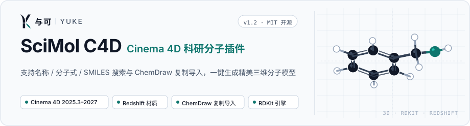

<div align="center">

<picture>
  <source media="(prefers-color-scheme: dark)" srcset="./assets/brand/scimol-hero-zh-dark.svg">
  <source media="(prefers-color-scheme: light)" srcset="./assets/brand/scimol-hero-zh-light.svg">
  
</picture>

<p>
  <b>简体中文</b> · <a href="./README.en.md">English</a>
  &nbsp;&nbsp;|&nbsp;&nbsp;
  <a href="#安装与-ai-适配">AI 一键安装</a> · <a href="#跨软件扩展">Blender / 多软件适配</a> · <a href="#核心亮点">核心亮点</a> · <a href="#快速上手">ChemDraw 联动</a>
</p>

</div>

专为**学术期刊封面（Cover Art）、TOC 摘要图、论文插图与科研机理动画**打造：免去跨软件导出 OBJ/FBX 与手动贴材质，直接在 Cinema 4D 内搜索或从 ChemDraw 粘贴结构，一键生成精准三维分子与材质；同时**开放完整几何内核与移植蓝图**，让你的 AI 也能轻松将这套工作流适配到任意 C4D 版本或 **Blender / Maya / Houdini** 等三维软件。

## 核心亮点

| 能力 | 说明 |
| :--- | :--- |
| **ChemDraw 联动** | 在 ChemDraw 中选中分子按 `Ctrl+Alt+C` 复制为 SMILES 直接粘贴生成，或一键导入 `.cdxml` / `.mol` / `.sdf` 文件 |
| **一框智能搜分子** | 中英文名、分子式（支持下标 `C₆H₁₂O₆`）、SMILES 自动识别；内置 81 词离线常用词库并联动 PubChem 在线检索 |
| **一键精美材质** | 球棍 / 空间填充 / 细棍骨架三模式切换；自动构建原子与双色化学键独立材质，自带 5 套科研配色预设（含单步撤销） |
| **丝滑实时调参** | 单击缩略图生成实时预览，切换分子自动替换当前预览不堆冗余；支持原子大小、键粗细、间距、氢显示及单元素缩放即时联动 |
| **实用附带工具** | 常用记录、自定义收藏夹与预设保存；右下角「结构详情」提供二维原子/环点选、单原子/单键微调与骨架拍平辅助 |

## 安装与 AI 适配

### 方式一：复制给任何 AI 自动安装并适配你的环境（推荐）

如果你正在使用 **Cursor、Claude Code、Codex、Trae、Windsurf、Antigravity** 等 AI 助手，点击下方代码块右上角复制发给它，它会自动完成下载、隔离配置化学环境，并按你电脑上的 C4D 版本与渲染器完成适配：

````text
请帮我在当前 Windows 电脑上安装并适配 Cinema 4D 插件「SciMol C4D」（仓库：https://github.com/DeepLeap/scimol-c4d）：
1. 检查本机是否有 64 位 Python（3.10~3.13）；若没有，请先征得我同意后用 winget 安装 Python 3.12。
2. 将 https://github.com/DeepLeap/scimol-c4d 下载（git clone 或下载 main 分支 ZIP 解压）到独立固定目录 `%APPDATA%\Maxon\SciMol-C4D`（注意：不要把完整项目直接放进 C4D 的 library\scripts 目录，以免扫描虚拟环境导致卡顿）。
3. 在该目录下执行 `powershell -ExecutionPolicy Bypass -File .\安装运行环境.ps1 -RegisterC4D`，自动配置项目本地隔离的 `.runtime` 化学环境并将轻量化启动器注册到 Cinema 4D「用户脚本」菜单。
4. 检测我电脑上实际安装的 Cinema 4D 版本以及常用渲染器（如 Redshift、C4D 标准渲染器、Octane 等）：如存在版本差异或未使用 Redshift，请先阅读仓库内的 `docs/AI_ADAPTER_GUIDE.md`，按其中第 4 节指引直接帮我调整 `scimol_c4d/c4d_builder.py` 的材质或兼容代码。
5. 完成后，用通俗中文告诉我安装位置、是否做过兼容调整，以及在 C4D 哪个菜单启动。
````

### 方式二：手动安装（3 步完成）

1. **下载到独立固定目录**（如 `D:\Plugins\scimol-c4d` 或 `%APPDATA%\Maxon\SciMol-C4D`，**不要**直接放进 C4D 的 `library\scripts`）
   ```bash
   git clone https://github.com/DeepLeap/scimol-c4d.git
   ```
2. **初始化独立化学环境并挂载 C4D 菜单**（需本机已有 64 位 Python 3.10~3.13；**完全不改动 C4D 内置 Python**，默认源较慢时自动切换国内镜像）
   ```powershell
   powershell -ExecutionPolicy Bypass -File .\安装运行环境.ps1 -RegisterC4D
   ```
3. **在 C4D 中启动**：打开或重启 Cinema 4D，点击顶部菜单 **扩展 (Extensions) → 用户脚本 (User Scripts) → 分子球棍生成器**；也可在「脚本管理器」中直接打开运行 `分子球棍生成器.py`。

## 跨软件扩展

> 以 **Cinema 4D** 为开箱主阵地，同时把整套原理共享给 **Blender / Maya / Houdini / 3ds Max** 用户。

本项目刻意将 **70% 的化学搜索、ChemDraw 解析、三维坐标计算、科研配色与双色键分界算法** 与 **30% 的 C4D 建模材质接口** 完全拆开；化学环境运行在独立的项目本地 `.runtime` 中，不依赖任何 3D 软件自带的 Python。完整原理与接口协议见 [**AI 跨版本与跨 3D 软件适配蓝图 (docs/AI_ADAPTER_GUIDE.md)**](./docs/AI_ADAPTER_GUIDE.md)。

如果你想在 **Blender**（或其他 3D 软件）里用上同款能力，只需把下面这段提示词里的目标软件改成你自己的，发给任意 AI 助手即可让它直接基于本仓库生成适配插件：

````text
请参考开源项目 https://github.com/DeepLeap/scimol-c4d 中的通用化学与几何内核，为我开发适配【目标软件：例如 Blender 4.x / Cycles（可改为 Maya / Houdini / 早期 C4D + Octane 等）】的科研三维分子插件：
1. 先克隆或下载该仓库，并认真阅读仓库内的 `docs/AI_ADAPTER_GUIDE.md`、核心数据协议及几何算法章节。
2. 直接复用仓库已有的 `.runtime` 化学解析后台（运行 `安装运行环境.ps1` 构建）、`scimol_c4d/chemistry_worker.py`、`display_geometry.py`、`appearance_scale.py` 与 `COLOR_PRESETS` 科研配色体系（支持名称/分子式/SMILES 搜索及 ChemDraw 复制导入），不要重写化学解析部分。
3. 参照 `scimol_c4d/c4d_builder.py` 中的球体缩放、多键偏移与双色共价键等长分界算法，用【目标软件】的原生 Python API 编写模型实例化、PBR/节点材质构建及简洁侧边栏 UI。
4. 保留原作者「与可 | YUKE (DeepLeap)」署名信息与 MIT 协议，并在完成后告诉我如何安装使用。
````

## 快速上手

```text
搜索或 ChemDraw 粘贴/导入 → 单击缩略图生成预览 → 调参 / 科研配色 → 点击「完成」定稿
                                   ↑                                      ↓
                                   └────────── 继续点击替换同一预览 ────────┘
```

- **ChemDraw 快捷键**：选中结构按 `Ctrl+Alt+C`（`Edit → Copy As → SMILES`），回到插件点击「粘贴」即刻生成。
- **材质共享与撤销**：默认开启「材质继承」，同元素材质可跨分子共享；切换科研配色后支持 `Ctrl+Z` 单步撤回。
- **二次接管模型**：点击「完成」冻结后，仍可通过「接管所选」重新绑定场景中未手工拆改的分子继续调参。

## 目录说明

```text
scimol-c4d/
├── 分子球棍生成器.py        # C4D 入口脚本
├── 安装运行环境.ps1         # 自动配置独立化学环境并注册 C4D 用户脚本菜单
├── requirements.txt         # 独立化学环境依赖清单
├── 脚本信息.json            # 插件基础元数据
├── 界面图标.png / 图标.png  # 菜单栏与展示图标
├── scimol_c4d/              # 核心源码（70% 通用化学几何内核 + 30% C4D 适配层）
├── docs/AI_ADAPTER_GUIDE.md # AI 跨版本与跨 3D 软件（Blender/Maya 等）移植架构蓝图
├── assets/                  # 界面图标与「与可 | YUKE」品牌矢量资产
└── 测试/                    # 本地单元测试（验证本地.py）与宿主验收脚本
```

## 系统与适用范围

| 项目 | 说明 |
| :--- | :--- |
| **开箱默认环境** | Windows · Cinema 4D（默认原生面板 + Redshift 节点材质；其他版本或标准/第三方渲染器可用上方 AI 提示词一键适配） |
| **化学后台依赖** | 本机需有 64 位 Python 3.10~3.13（仅用于隔离创建 `.runtime` 化学解析环境，不改动 C4D/Blender 内置环境） |
| **支持分子范围** | 单个共价连接分子，最多 300 个原子（含氢）；暂不支持盐、晶体晶胞、蛋白质大分子及图片 OCR 识图 |

<details>
<summary>开发者本地自检命令</summary>

```powershell
.\.runtime\Scripts\python.exe 测试\验证本地.py
```

</details>

---

<div align="center">
  <sub><a href="./LICENSE">MIT License</a> © 2026 <a href="https://github.com/DeepLeap">YUKE (DeepLeap)</a> · 与可科研可视化</sub>
</div>
